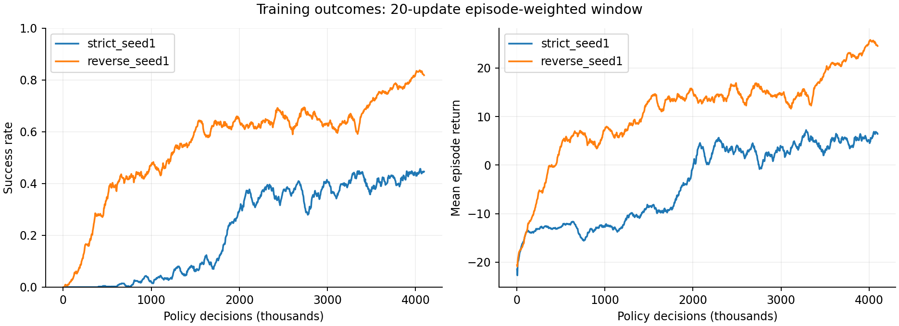
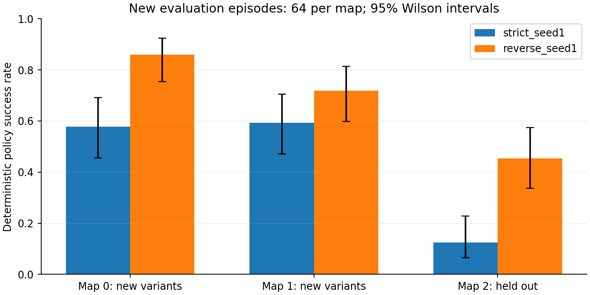

# IAEML. Assignment 2: PPO с задним ходом

Автор: Mikhail Tereshchenko, DS-01 <br>
Дата эксперимента: 27 ноября 2026 года

## 1. Постановка

Во втором задании я хотел обучить автомобиль доезжать до цели и сравнить,
как возможность заднего хода влияет на результат. Финальный запуск называется
`reverse_seed1`. **Для обучения и выбора весов я использовал карты 0 и 1,
а карту 2 оставил для проверки переноса на другую геометрию.** Мне было важно
посмотреть как успешные проезды, так и ситуации, в которых агент ошибается.

Среда `RobotaxiEnv(BaseEnv)` описана в [отчёте Assignment 1](REPORT_ASSIGNMENT1.md).
Собственный класс реализует велосипедную модель с сопротивлением. Скорость
подписана: вперёд до 3 м/с, назад до 1,5 м/с. Противоположная команда сначала
тормозит до нуля, затем разгоняет в другом направлении. Сопротивление уменьшает
модуль скорости, а знак поворота зависит от направления движения.
Преподавательские файлы, карты и зависимости сохранены.

Действие - два числа в `[-1,1]`: продольная команда и целевой угол руля.
Наблюдение содержит 43 признака: скорость, руль, цель, смещение и касательную
пути в системе автомобиля, предыдущее действие, время и 32 лучевые дальности.
На вход сети я подаю четыре последних наблюдения, то есть 172 признака.
При сбросе история заполняется новым начальным наблюдением, чтобы в ней
не оставались данные прошлого эпизода. Сравнение последовательных наблюдений
помогает оценивать движение видимых препятствий, хотя всей информации о среде
у агента всё равно нет.

## 2. Разнообразие и разделение данных

Чтобы обучение не сводилось к одному началу движения, я использовал по 256
вариантов каждой обучающей карты. В них меняются старт, направление машины,
фаза движения препятствий (0-12 с) и отражение карты. Цель и скорости
препятствий отражаются согласованно. Около 35% обучающих вариантов сохраняют
исходный старт с разбросом курса около +-27°; остальные используют свободные
старты и курс из полного круга. Курс выбирается заново при каждом сбросе.
Ограничения исходного старта сохранены для сопоставимости экспериментов.

Для свободных стартов я использовал точки полуметровой сетки с зазором больше
2,1 м до статических препятствий. Их разделение на обучение, validation и test
фиксировано и учитывает отражения: зеркальная копия обучающего старта тоже
не может попасть в другой набор. Автомобиль
мог проезжать через тестовые координаты при обучении; они исключены именно как
начальные точки. Вариативные validation/test-группы не используют исходный старт:
он оценивается отдельно. 64 эпизода не означают 64 различных координаты.

| Набор | Карты | Seed | Эпизоды оценки на карту |
| --- | --- | --- | --- |
| Обучение | 0, 1 | 1 | поток из обучающих банков |
| Validation | 0, 1 | 20000 | 32 вариации и исходный сценарий |
| Итоговый тест | 0, 1, 2 | 30000 | 64 вариации и исходный сценарий |

Курсы и фазы получают независимые выборки с другими seeds. Скрипт выбора
отклоняет тестовые старты и карту 2. Её геометрия ранее диагностировалась,
поэтому она не называется впервые открытым слепым тестом; она исключена
из обучающих обновлений и выбора весов. Подробности - в [readme.md](readme.md#разделение-обучения-и-проверки).

При этом агент получает опорный маршрут по статическим препятствиям текущей
карты, в том числе тестовой. Планировщик учитывает зазор, но не выбирает за
нейросеть ускорение или руль. На движущиеся препятствия она должна реагировать
по лучам. Поэтому здесь я проверяю, как переносится управление с навигационной
подсказкой; самостоятельное изучение неизвестной карты в задачу не входит.

## 3. PPO-Clip

Для обучения я использовал реализацию PPO-Clip на JAX и Optax по
[Schulman et al., Proximal Policy Optimization Algorithms](https://arxiv.org/abs/1707.06347).
Actor и critic — отдельные MLP, каждая с двумя скрытыми слоями по 128 нейронов
и активацией `tanh`. Actor задаёт среднее диагонального гауссова распределения;
два обучаемых `log_std` ограничены `[-3,1]`. Действие равно `tanh(z)`;
логарифм плотности учитывает якобиан преобразования.

В этой реализации PPO сначала собирает опыт текущей политикой, затем несколько
раз обновляет модель по этому пакету и после этого собирает новые данные.
Старые переходы не хранятся в долгоживущем replay buffer. Actor задаёт
распределение действий для текущего наблюдения. Critic оценивает ожидаемую
будущую дисконтированную награду состояния. На основе его оценок и полученных
наград вычисляются преимущества GAE, которые используются для обновления actor.
Перед обновлением преимущества нормируются по пакету.

```text
ratio = exp(log π_new(u|s) - log π_old(u|s))
L_policy = -mean(min(ratio·A, clip(ratio,1-ε,1+ε)·A))
L_value = 0.5·mean((V(s)-target)²)
L_total = L_policy + 0.5·L_value - 0.005·entropy
```

Смысл обрезки PPO я рассматриваю как ограничение слишком большого изменения
вероятностей уже собранных действий за одно обновление. При этом она сама по
себе не задаёт строгую границу KL. Дополнительно обновления пакета
останавливаются при minibatch-оценке KL выше 0,03. Энтропия ограниченного
распределения оценивается методом Монте-Карло и может быть отрицательной.
Value clipping не применяется. При успехе/столкновении bootstrap обнуляется;
при тайм-ауте используется оценка финального наблюдения до сброса. GAE
не переносится в следующий эпизод.

| Параметр | Значение |
| --- | --- |
| Среды | 16 на карту, всего 32 |
| Rollout / пакет | 128 решений / 4096 переходов |
| Обновления / решения | 1000 / 4 096 000 |
| Эпохи / minibatch | 4 / 256 |
| Adam learning rate / epsilon | 0,0003 / 0,00001 |
| Gamma / GAE lambda | 0,995 / 0,95 на решение |
| PPO clip / max gradient norm | 0,2 / 0,5 |
| Повтор действия | 6 физических шагов |
| Физика / решения | 60 Гц / 10 Гц |
| Максимум эпизода | 1800 физических шагов, 30 с |

## 4. Награда и оптимизации

Для обучения я использовал награду из первого задания. Она учитывает прогресс
к цели и штрафует время, отклонение от пути, близость препятствий, величину
и изменение действия. Успех даёт +20, столкновение −20,
тайм-аут -2. Точная формула - в отчёте первого этапа и `src/env/robotaxi.py`.
Текущий штраф отслеживания считается относительно старого пути при его
перестроении. Евклидов прогресс может мешать обходу, требующему временно
удаляться от цели; коэффициенты не гарантируют сохранение оптимальной политики.

Чтобы обучение выполнялось быстрее, сбор опыта, повтор действий, GAE
и обновления собраны через `jit` и `lax.scan`. Нейросети обрабатывают сразу
пакет наблюдений матричными операциями. Карты с разными формами массивов
исполняются отдельно. Опорные маршруты рассчитываются на CPU при подготовке
банка, а результаты для отражённых геометрий используются повторно.

Шаг среды исполняется через `lax.map`: прямой `vmap` над зависящим от состояния
`lax.cond` вычислял бы обе ветви, включая ненужное построение пути. Микротест
одинаковых состояний ранее показал около 20-кратного ускорения этого участка
с совпадением результатов (`results/assignment2/benchmark.json`). Это не
утверждение о 20-кратном ускорении всего обучения.

В финальном запуске медианная скорость полного цикла — около 16 тыс. решений/с;
основной цикл занял 328,76 с, без подготовки банков до таймера. Зафиксированы
Python 3.12.15, JAX 0.8.0, Equinox 0.13.2, Optax 0.2.6, NumPy 2.3.4, CPU macOS arm64.
Версии, конфигурация и хеши исходников сохранены в `train/runtime.json` запуска.
Зависимости не устанавливались и не обновлялись при реализации.

## 5. Выбор модели и результаты

Для выбора весов я сравнил checkpoints после 200/400/600/800/1000 обновлений
только на validation карт 0 и 1.
Критерий - половина среднего успеха исходных сценариев плюс половина среднего
успеха вариативных эпизодов; при равенстве - меньше столкновений. Выбрана точка
1000, score = 0,9140625. Точка 600 имела тот же score, но больше столкновений.
После фиксации весов проведён итоговый тест.

| Карта, 64 новых эпизода | Без заднего хода | С задним ходом | Столкновения с задним ходом | Тайм-ауты |
| --- | --- | --- | --- | --- |
| 0, обучающая геометрия | 37/64 | 55/64 = 85,9% | 9/64 | 0/64 |
| 1, обучающая геометрия | 38/64 | 46/64 = 71,9% | 17/64 | 1/64 |
| 2, вне обучения | 8/64 | 29/64 = 45,3% | 34/64 | 1/64 |

В сравнении я использовал одинаковые seed, постановку и начальные тестовые
условия. Отличается возможность заднего хода и соответствующее наблюдение
скорости. Таким образом можно увидеть разницу для этой пары запусков,
но делать вывод о среднем эффекте по многим seeds пока нельзя.
Исходные сценарии карт 0 и 1 пройдены. Исходный сценарий карты 2 заканчивается
столкновением при движении назад. Надёжный перенос на третью карту не получен.

Средняя доля успехов на обучающих эпизодах выросла с 13,8% в первых 100
обновлениях до 79,9% в последних 100. В проверенных потерях и весах нет NaN/Inf.
При этом на третьей карте осталось 34 столкновения из 64. Поэтому я не могу
сказать, что управление уже стало надёжным: если машина перестала стоять,
но затем врезалась, такую попытку всё равно нельзя считать успешной.





Интервалы Уилсона относятся к конечной выборке эпизодов, а не к разбросу между
seeds обучения. Один seed, три карты и ограниченный набор свободных стартов
сужают выводы. Исходные прогоны содержат всего по одному эпизоду.

## 6. Проверки, видео, воспроизведение

Для проверки реализации использованы 33 теста физики, заднего хода, PPO, GAE,
навигации и разделения данных; все они прошли
(`results/reverse/tests.txt`). Дополнительная проверка повторила все 195 эпизодов
итогового теста: исходы совпали. Задний ход использовался в 40/64, 37/64 и 53/64
вариативных эпизодах карт 0/1/2. Это показывает использование возможности,
но не доказывает её необходимость для каждого отдельного манёвра.

| Видео исходного сценария | Результат | Длительность |
| --- | --- | --- |
| [Карта 0](results/assignment2/reverse_seed1/videos/map0.mp4) | успех | 8,9 с |
| [Карта 1](results/assignment2/reverse_seed1/videos/map1.mp4) | успех | 8,3 с |
| [Карта 2](results/assignment2/reverse_seed1/videos/map2.mp4) | столкновение | 19,8 с |

Ролики записаны детерминированной политикой без ручной коррекции, 800×400,
10 кадров/с. Они не заменяют статистику вариативных эпизодов.
Веса - [best_validation.npz](results/assignment2/reverse_seed1/best_validation.npz).
Команды просмотра, оценки и обучения - в [readme.md](readme.md).
Checkpoint содержит модель и конфигурацию для inference, но не состояние Adam
для точного продолжения обучения. Новые пакеты не требуются для запуска модели;
ffmpeg нужен только для записи видео, matplotlib - для необязательных PNG-графиков.

## 7. Технические трудности

При разборе остановки на третьей карте в исходном маршруте нашёлся отрезок,
который проходит в 0,707 м от центра препятствия при пороге коллизии около 1 м.
То есть подсказка пути сама могла вести слишком близко к препятствию. Поэтому
в модуль RL добавлен отдельный планировщик с зазором, без правок преподавательского кода. Безопасность ломаной не гарантирует проезд
велосипедной модели: скорость, своевременный поворот и реакцию на движущиеся
препятствия должна выбирать политика.

Пакетирование условных функций потребовало `lax.map`, чтобы не рассчитывать
ненужные ветви. Для проверки новых стартов разделены пространственные пулы
с учётом отражений. При добавлении заднего хода исправлены нормировка скорости
и диагностика остановок по `abs(speed)`; старые веса сохраняют прежнюю физику.
Несмотря на улучшение, агент иногда сталкивается, в том числе сдавая назад.
Следующие возможные проверки — несколько seeds и улучшения по validation 0/1.
Карта 2 должна оставаться вне обучения для сохранения выбранной постановки.

## 8. Личная рефлексия

В этом задании мне было интересно проверить разницу между результатами агента,
обученного на модели машины без заднего хода, и агента, у которого такая
возможность есть. До начала работы я представлял обучение как многократное
повторение одной задачи: агент ошибается, не доходит до цели, но постепенно
учится обходить препятствия и выбирать более подходящие действия. При этом
само обучение не гарантирует улучшение после каждой попытки: результаты
могут колебаться, поэтому нужно отдельно
проверять и выбирать сохранённые веса. Самыми непонятными для меня были PPO
и роль critic.

При разборе реализации я лучше понял общую идею обучения с подкреплением.
Actor я понимаю как часть модели, которая по текущему наблюдению задаёт
распределение возможных действий. При обучении из него выбирается действие,
а при оценке используется детерминированный вариант. Critic мне удобно
сравнить с учителем, который помогает оценивать результат, но в коде он
не выдаёт правильное действие и не задаёт саму награду. Он оценивает ожидаемую
будущую награду по полученным наблюдениям, а сравнение этой оценки с полученными наградами
помогает обновлять actor. При этом мне ещё нужно подробнее разобраться
в принципах RL и в том, как лучше настраивать награду и обучение, чтобы агент
обобщал поведение, а не запоминал один конкретный сценарий.

Одной из моих основных проблем было опасение, что агент запомнит привычное
начало движения - например, что сначала нужно ехать вверх и вправо.
На другой карте или при другом направлении старта такой способ уже может
не работать. Поэтому в итоговом варианте обучение устроено на двух картах,
с разными позициями старта, случайными направлениями и фазами препятствий.
Таким образом цель может находиться с разных сторон относительно машины.
Отдельно проверяется, как агент ведёт себя на новых стартах знакомых карт
и на третьей карте, на которой он не обучался.

Во время проверки я обратил внимание на то, что третью карту, то есть карту 2,
агент проходит намного хуже. Сначала я связывал это с недостаточным обучением
или с тем, что он слишком привык к определённой конфигурации. По видео я также
заметил ситуации, в которых машина останавливается перед препятствием
и не может отъехать назад. Поэтому я решил добавить задний ход и сравнить
результаты. При этом отсутствие заднего хода оказалось не единственным
возможным объяснением: при диагностике нашлась и небезопасная подсказка пути,
а после добавления заднего хода часть попыток всё равно заканчивается
столкновением. Значит, дело также в выборе самого манёвра.

В финальном эксперименте агент достиг цели в 55 из 64 эпизодов на карте 0,
в 46 из 64 на карте 1 и в 29 из 64 на третьей карте. Я понимаю это так:
на новых условиях внутри знакомых карт он справляется заметно лучше, чем
на другой геометрии, которую не видел при обучении. По видео у меня возникло
предположение, что в некоторых местах третьей карты машине нужно успеть
проехать между движущимися препятствиями, а времени на разгон и манёвр
оказывается мало. Но отдельного измерения таких временных окон я не проводил,
поэтому пока рассматриваю это как гипотезу, а не как установленную причину
всех неудач. Наблюдаемый результат - столкновения и недостаточно надёжный объезд.

При этом добавление заднего хода довольно заметно улучшило результаты этой
пары запусков. Агент действительно использует движение назад, но возможность
сдать назад сама по себе не решает все проблемы: ему ещё нужно правильно
выбирать скорость, момент движения и поворот, чтобы не врезаться.

Если бы я продолжал работу, я бы попробовал больше конфигураций для обучения
и отдельно больше тестовых карт, чтобы проверить, насколько агент способен
адаптироваться к ранее неизвестным условиям. При этом я бы сохранил разделение:
не использовал бы тестовую карту для обучения и выбора весов, а новые геометрии
заранее распределил бы между обучением и проверкой. Мне было бы интересно
понять, какие изменения действительно помогают обобщению, а не просто
улучшают результат на одном уже известном сценарии.
